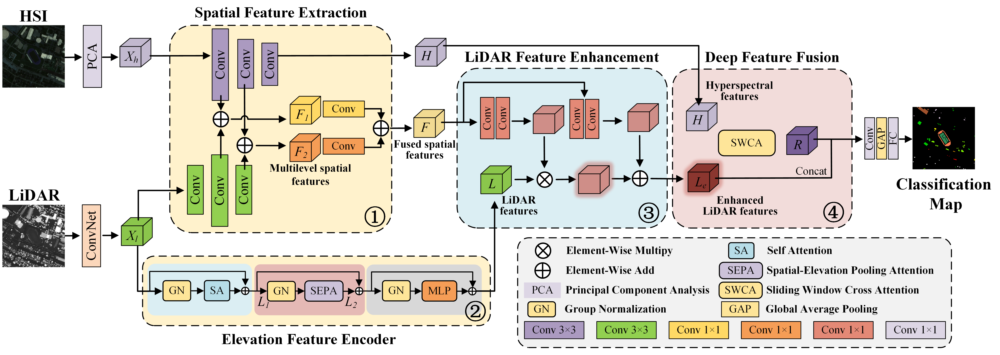

# Spatial-Guided LiDAR Spatial-Elevation Feature Enhancement Network for Fusion Classification of Hyperspectral and LiDAR Data

Here, we provide the pytorch implementation of the paper: Spatial-Guided LiDAR Spatial-Elevation Feature Enhancement Network for Fusion Classification of Hyperspectral and LiDAR Data.

The implementation details of the model will be made public after the paper is received.



## Requirements

```
Python 3.9.7
pytorch 1.9.0
torchvision 0.10.0
numpy  1.22.2
timm   0.4.x
scikit-learn
scipy
tqdm
```

> Environment notes
> - A CUDA-capable GPU is required: the scripts call `model.cuda()`.
> - Keep `numpy < 1.24`, because the code uses the deprecated `np.int` alias.
> - Keep `timm < 1.0`, because `timm.models.layers` was removed in later releases.
> - The metrics are appended to `result/SGFEN.txt` inside each dataset folder; the file is
>   already provided as an empty placeholder.

## Results
| Dataset | OA(%) | AA(%) | Kappa×100 |
| :----: | :----: | :----: | :----: |
| Houston  | 96.32 | 96.44 | 96.01 |
| Trento  | 99.09 | 98.52 | 98.78 |
| MUUFL  | 90.61 | 91.01 | 87.70 |
| Yellow  | 94.11 | 94.95 | 92.58 |

## Train SGFEN

Each dataset is self-contained in its own folder with its own `utils.py`, `model/` and
`data/`. The scripts use relative paths (`from model.SGFEN import SGFEN` and `./data/...`),
so they must be executed **from inside the corresponding dataset folder**.

Houston:
```
cd Houston
python SGFEN-Houston.py
```

Trento:
```
cd Trento
python SGFEN-Trento.py
```

MUUFL:
```
cd MUUFL
python SGFEN-MUUFL.py
```

Yellow:
```
cd Yellow
python SGFEN-Yellow.py
```

The metrics of each run are appended to `result/SGFEN.txt` inside the same folder.

## Data Download
Houston: https://pan.baidu.com/s/13c0h5A1fnJOKWkuG9oZlig?pwd=ouhw

Trento: https://pan.baidu.com/s/1fTM4iUZOdd7LeZ1iKkVvoA?pwd=6z62

MUUFL: https://pan.baidu.com/s/1nXBUFR-KDa-q_npbkmMh1Q?pwd=wi62

Yellow: The dataset is not publicly released yet.

See the `data/README.md` inside each dataset folder for the required file names and the
expected directory layout.
